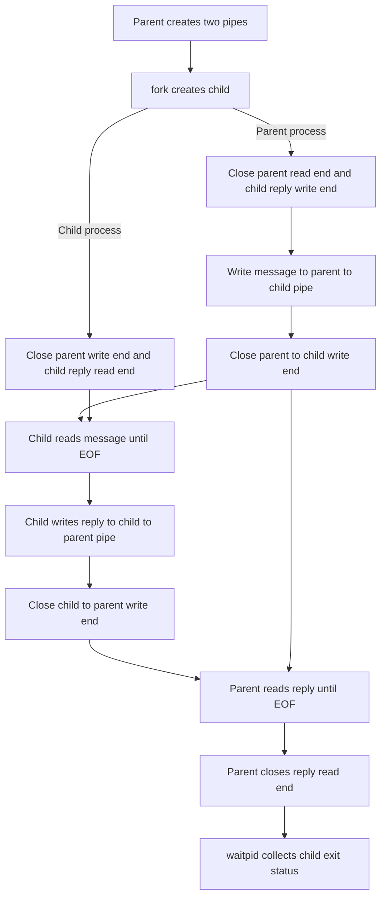

# Pipe based interprocess communication in C

This project demonstrates two way communication between a parent process and its child process using POSIX unnamed pipes. It is a user space demonstration built on the operating system's `pipe()`, `fork()`, `read()`, and `write()` system calls.

## Process flow

The parent creates both pipes before `fork()`. After the fork, the parent and child close the pipe ends they do not use. The arrows below show the order of the message exchange and the point where closing a writer lets the reader receive EOF.



## Build and run

Requires a C compiler and a POSIX environment such as Linux, macOS, or WSL. Windows PowerShell alone does not provide `fork()` or POSIX unnamed pipes.

```sh
make
./pipe_ipc
```

Or compile directly:

```sh
cc -std=c11 -Wall -Wextra -Wpedantic -O2 main.c -o pipe_ipc
./pipe_ipc
```

Expected output (the order can vary because parent and child run concurrently):

```text
Child received: Hello child, this message traveled through a pipe.
Parent received: Hello parent, I received your message.
```

See [docs/architecture.md](docs/architecture.md) for the descriptor ownership table, detailed data flow, and pipe behavior.
