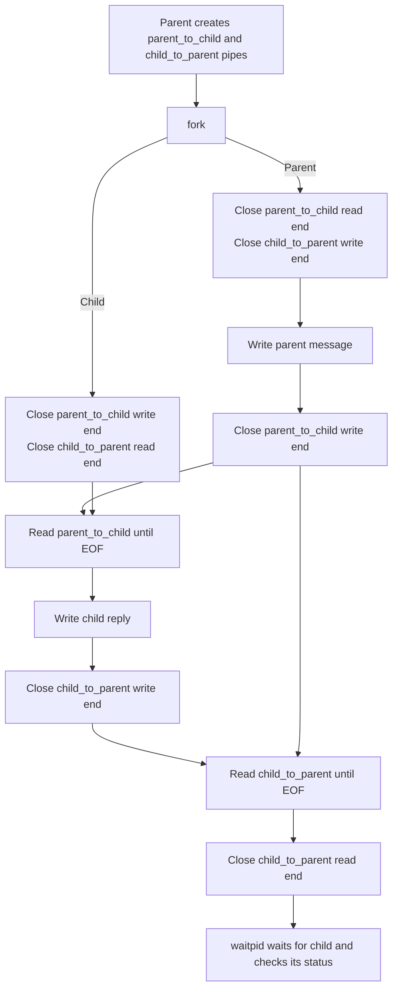

# Pipe IPC architecture

This document describes the implementation in [`main.c`](../main.c). The diagram is fixed: changing the message contents does not change the processes, descriptors, or connections.

## Process and message flow

The parent creates two pipes, then calls `fork()`. Both processes inherit all four descriptors. Each process closes the ends it does not use before communicating.

## Descriptor ownership

Each pipe is unidirectional. The parent-to-child pipe carries the first message; the child-to-parent pipe carries the reply.

| Pipe end | Parent process | Child process | Use |
| --- | --- | --- | --- |
| `parent_to_child[0]` (read) | Closes | Keeps open, then closes after reading | Child reads the parent's message. |
| `parent_to_child[1]` (write) | Keeps open, then closes after writing | Closes | Parent writes the first message. |
| `child_to_parent[0]` (read) | Keeps open, then closes after reading | Closes | Parent reads the child's reply. |
| `child_to_parent[1]` (write) | Closes | Keeps open, then closes after writing | Child writes the reply. |

## Ordering and EOF

1. The parent writes its message, then closes `parent_to_child[1]`.
2. The child reads the available bytes. Since no process still has that pipe's write end open, the child's next read sees EOF and the message is complete.
3. The child writes its reply, then closes `child_to_parent[1]`.
4. The parent reads the reply until EOF, closes `child_to_parent[0]`, and calls `waitpid()` to collect the child's exit status.

The parent does not wait for the child before reading the reply. Both processes can make progress: the parent closes its request writer, the child observes EOF and replies, and the parent observes EOF once the child's reply writer closes.

## Message size and limitations

`read_message()` stores at most `MESSAGE_CAPACITY - 1` bytes and adds a terminating null byte. The demonstration's fixed messages fit in the buffer. If a sender writes more than the buffer can hold, this function returns the first `MESSAGE_CAPACITY - 1` bytes; it is not a general length-prefixed message protocol.

These are unnamed pipes, so this example communicates between related processes created by `fork()`. An ordinary pipe is one way, which is why two pipes are needed for a request and reply. The pipe carries bytes; message boundaries are established here by closing the writer and reading until EOF.
